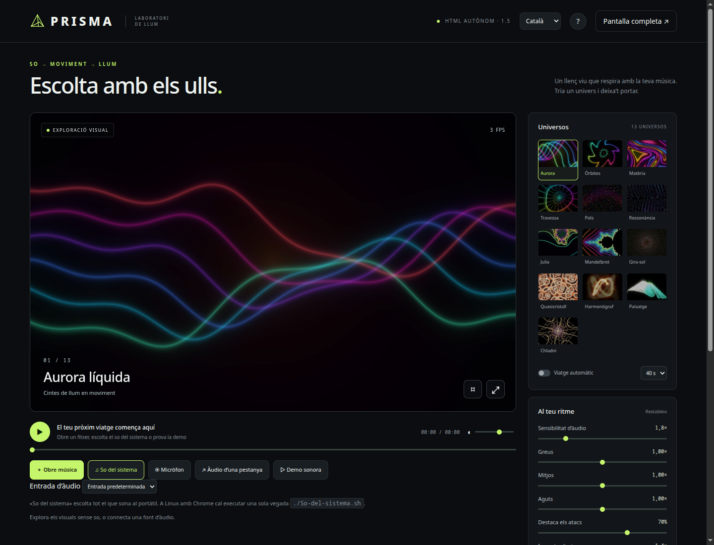

# Prisma

[Català](README.md) · [Español](README.es.md) · **English**

Prisma is a music visualiser that turns sound into light. It is a single HTML file using WebGL 2 and Web Audio: **open it with a double click**, with no server, no installation and no internet connection. Your music never leaves the browser.



## Getting started

1. Download `Prisma.html`, or the whole repository.
2. Double-click it to open it in an up-to-date Chrome, Edge or Firefox.
3. Pick a sound source:
   - **＋ Open music:** MP3, WAV, OGG, FLAC or M4A files. You can also drag them onto the window.
   - **♫ System sound:** everything playing on the computer (Spotify, YouTube, a media player…). See below.
   - **◉ Microphone**.
   - **↗ Tab audio:** one specific Chrome or Edge tab.
   - **▷ Sound demo:** a synthetic piece generated on the fly.

Choose the language (Catalan, Spanish or English) from the selector in the header. You can also force it with `Prisma.html?lang=es` or `?lang=en`.

## System sound

Prisma looks for an audio input that carries what comes out of the speakers. It does not play it back, and the input is opened without echo cancellation so the music is not erased.

| System | What to do |
| --- | --- |
| **Linux + Firefox** | Nothing. Firefox lists the output monitors ("Monitor of…") and Prisma picks the right one. |
| **Linux + Chrome** | Chrome hides monitors. Run `./So-del-sistema.sh` once: using PipeWire, it creates the virtual input **"Prisma · so del sistema"**, which follows the default output and survives reboots. `./So-del-sistema.sh desactiva` removes it, and `./So-del-sistema.sh estat` tells you whether it is active. It is a user service, so no admin rights are needed. |
| **Windows** | Enable "Stereo Mix" in the sound settings. |
| **macOS** | You need a loopback device such as BlackHole or Loopback. |

## Universes

| | Universe | Idea |
| --- | --- | --- |
| 1 | Liquid aurora | Waving ribbons of light. |
| 2 | Infinite orbits | Radial symmetries breathing with the bass. |
| 3 | Living matter | Plasma with iterated warping. |
| 4 | Crossing | A radial tunnel. |
| 5 | Stardust | Layered procedural particles. |
| 6 | Resonance | The trace of the waveform. |
| 7 | Julia garden | **Exact infinite zoom** into a repelling periodic point of the Douady rabbit (c = −0.122 + 0.745i). Thanks to the Poincaré function, every loop ends on exactly the shape it started with. |
| 8 | Mandelbrot | **Infinite zoom** into the period-3 minibrot (c ≈ −1.7549, scale 0.019): the Mandelbrot living inside the Mandelbrot. |
| 9 | Fibonacci sunflower | Seeds born at the centre at the golden angle, opening into 21 and 34 spirals. Each ring is a band of the spectrum. |
| 10 | Quasicrystal | Seven plane waves at 360°/7 interfering, each one driven by a band of the sound. The image is solarised (Sabattier effect). |
| 11 | Harmonograph | Two damped pendulums draw with light on a dark background, and the drawing sinks into a continuous zoom. |
| 12 | Spectral landscape | A mountain range of spectrum lines in perspective: the present in front, the past behind. |
| 13 | Chladni tunnel | A flight through plates of vibrating sand. Each plate shows the nodal pattern of the pitch that was playing. |

In the fractals, the level curves outside the set light up like an equaliser, and every beat sends a wave of light inwards. The bass speeds up the journeys, tunnels and zooms.

## Controls

- **Sensitivity, Bass, Mids and Highs:** how much each band drives the visuals (the sound is not changed).
- **Emphasise attacks:** lowers the weight of sustained sound so the beats move the image again.
- **Rhythmic impact** and **Release:** how strong the response is and how fast it fades.
- **Persistence, Speed, Colour and Quality**.
- **Auto journey:** switches universe every 20, 40 or 60 seconds.
- **Shortcuts:** space, play or pause; ←/→, universe; F, full screen; H, hide controls; Esc, show them again.

## Development

No dependencies: you only need Node to build and test.

```bash
npm run build   # bundles src/ and dist/*.js into Prisma.html and dist/index.html
npm test        # analysis, audio source, translation and standalone HTML tests
npm run check   # module syntax
python3 tools/shader-check.py   # compiles and renders the shaders with EGL/OpenGL ES (needs libEGL and ImageMagick)
node tools/browser-check.mjs    # headless Chrome test (PRISMA_CHROME variable)
```

| File | Purpose |
| --- | --- |
| `src/index.template.html` | Interface template, in Catalan. |
| `dist/i18n.js` | Spanish and English translations. The Catalan text is the key. |
| `dist/analysis.js` | Bands, beat detection, envelope and the universe catalogue. |
| `dist/audio.js` | Audio sources (files, system, microphone, tab and demo) and FFT analysis. |
| `dist/visual.js` | WebGL 2 engine and all the shaders. |
| `dist/app.js` | Interface, preferences and thumbnails. |
| `So-del-sistema.sh` | PipeWire virtual input for Chrome on Linux. |

Prisma is inspired by classic visualisers such as MilkDrop, but every universe is original and it does not load `.milk` files.
