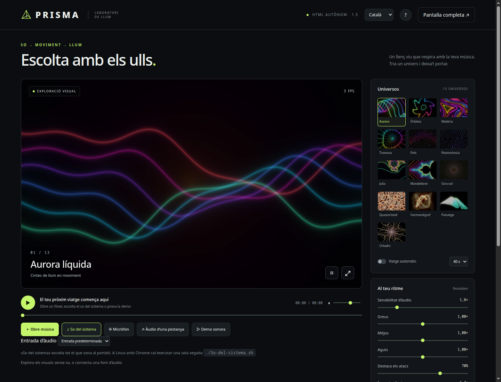

# Prisma

[Català](README.md) · **Español** · [English](README.en.md)

Prisma es un visualizador musical que convierte el sonido en luz. Es un único archivo HTML con WebGL 2 y Web Audio: **se abre con doble clic**, sin servidor, sin instalación y sin conexión. La música nunca sale del navegador.



## Cómo se abre

1. Descarga `Prisma.html`, o todo el repositorio.
2. Ábrelo con doble clic, con Chrome, Edge o Firefox actualizados.
3. Elige una fuente de sonido:
   - **＋ Abre música:** archivos MP3, WAV, OGG, FLAC o M4A. También puedes arrastrarlos a la ventana.
   - **♫ Sonido del sistema:** todo lo que suena en el ordenador (Spotify, YouTube, un reproductor…). Más abajo se explica cómo.
   - **◉ Micrófono**.
   - **↗ Audio de una pestaña:** una pestaña concreta de Chrome o Edge.
   - **▷ Demo sonora:** una pieza sintética generada al momento.

El idioma (catalán, castellano o inglés) se elige en el selector de la cabecera. También se puede forzar con `Prisma.html?lang=es` o `?lang=en`.

## Sonido del sistema

Prisma busca una entrada de audio que lleve lo que sale por los altavoces. No lo vuelve a reproducir, y la entrada se abre sin cancelación de eco para que la música no se borre.

| Sistema | Qué hay que hacer |
| --- | --- |
| **Linux + Firefox** | Nada. Firefox muestra los monitores de salida («Monitor of…») y Prisma elige el bueno. |
| **Linux + Chrome** | Chrome oculta los monitores. Ejecuta una vez `./So-del-sistema.sh`: con PipeWire crea la entrada virtual **«Prisma · so del sistema»**, que sigue la salida predeterminada y se mantiene tras reiniciar. `./So-del-sistema.sh desactiva` la quita, y `./So-del-sistema.sh estat` dice si está activa. Es un servicio de usuario, no hace falta ser administrador. |
| **Windows** | Activa «Mezcla estéreo» en las opciones de sonido. |
| **macOS** | Hace falta un dispositivo de bucle, como BlackHole o Loopback. |

## Universos

| | Universo | Idea |
| --- | --- | --- |
| 1 | Aurora líquida | Cintas de luz ondulantes. |
| 2 | Órbitas infinitas | Simetrías radiales que respiran con los graves. |
| 3 | Materia viva | Plasma con deformación iterada. |
| 4 | Travesía | Túnel radial. |
| 5 | Polvo estelar | Partículas procedimentales en capas. |
| 6 | Resonancia | El trazo de la forma de onda. |
| 7 | Jardín de Julia | **Zoom infinito exacto** hacia un punto periódico repulsivo del conejo de Douady (c = −0,122 + 0,745i). Gracias a la función de Poincaré, cada vuelta del bucle acaba en la misma forma en la que empieza. |
| 8 | Mandelbrot | **Zoom infinito** hacia el minibrot de periodo 3 (c ≈ −1,7549, escala 0,019): el Mandelbrot que vive dentro del Mandelbrot. |
| 9 | Girasol de Fibonacci | Semillas que nacen en el centro con el ángulo áureo y se abren en espirales de 21 y 34. Cada anillo es una banda del espectro. |
| 10 | Cuasicristal | Siete ondas planas a 360°/7 que interfieren, cada una movida por una banda del sonido. La imagen está solarizada (efecto Sabattier). |
| 11 | Armonógrafo | Dos péndulos amortiguados dibujan con luz sobre fondo oscuro, y el dibujo se adentra en un zoom continuo. |
| 12 | Paisaje espectral | Una cordillera de líneas de espectro en perspectiva: el sonido de ahora delante, el pasado al fondo. |
| 13 | Túnel de Chladni | Vuelo a través de placas de arena vibrante. Cada placa tiene la figura nodal del tono que sonaba. |

En los fractales, las curvas de nivel del exterior se encienden como un ecualizador y cada golpe envía una onda de luz hacia dentro. Los graves aceleran los viajes, los túneles y los zooms.

## Controles

- **Sensibilidad, Graves, Medios y Agudos:** cuánto afecta cada banda a los visuales (no cambian el sonido).
- **Destaca los ataques:** quita peso al sonido sostenido para que los golpes vuelvan a mover la imagen.
- **Impacto rítmico** y **Decaimiento:** la fuerza de la respuesta y lo rápido que se apaga.
- **Persistencia, Velocidad, Color y Calidad**.
- **Viaje automático:** cambia de universo cada 20, 40 o 60 segundos.
- **Atajos:** espacio, reproducción o pausa; ←/→, universo; F, pantalla completa; H, oculta los controles; Esc, los recupera.

## Desarrollo

No hacen falta dependencias: solo Node para construir y probar.

```bash
npm run build   # empaqueta src/ y dist/*.js en Prisma.html y dist/index.html
npm test        # pruebas de análisis, fuentes de audio, traducciones y HTML autónomo
npm run check   # sintaxis de los módulos
python3 tools/shader-check.py   # compila y renderiza los shaders con EGL/OpenGL ES (requiere libEGL e ImageMagick)
node tools/browser-check.mjs    # prueba en Chrome sin interfaz (variable PRISMA_CHROME)
```

| Archivo | Función |
| --- | --- |
| `src/index.template.html` | Plantilla de la interfaz, en catalán. |
| `dist/i18n.js` | Traducciones castellana e inglesa. El texto catalán es la clave. |
| `dist/analysis.js` | Bandas, detección de golpes, envolvente y catálogo de universos. |
| `dist/audio.js` | Fuentes de audio (archivos, sistema, micrófono, pestaña y demo) y análisis FFT. |
| `dist/visual.js` | Motor WebGL 2 y todos los shaders. |
| `dist/app.js` | Interfaz, preferencias y miniaturas. |
| `So-del-sistema.sh` | Entrada virtual de PipeWire para Chrome en Linux. |

Prisma se inspira en los visualizadores clásicos como MilkDrop, pero todos los universos son originales y no carga archivos `.milk`.
