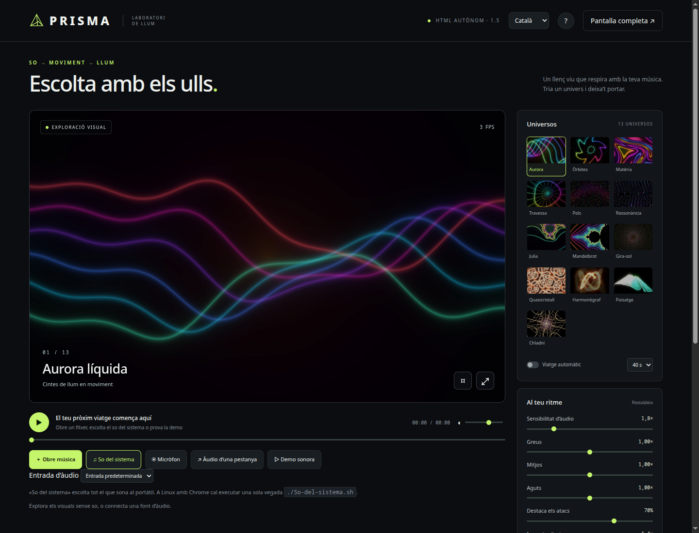

# Prisma

**Català** · [Español](README.es.md) · [English](README.en.md)

Prisma és un visualitzador musical que converteix el so en llum. És un únic fitxer HTML amb WebGL 2 i Web Audio: **s'obre amb doble clic**, sense servidor, sense instal·lació i sense connexió. La música no surt mai del navegador.

**Prova'l en línia:** https://guirigall.github.io/Prisma/ (o descarrega `Prisma.html` i obre'l amb doble clic).



## Com s'obre

1. Descarrega `Prisma.html`, o tot el repositori.
2. Obre'l amb doble clic, amb Chrome, Edge o Firefox actualitzats.
3. Tria una font de so:
   - **＋ Obre música:** fitxers MP3, WAV, OGG, FLAC o M4A. També els pots arrossegar a la finestra.
   - **♫ So del sistema:** tot el que sona a l'ordinador (Spotify, YouTube, un reproductor…). Vegeu més avall.
   - **◉ Micròfon**.
   - **↗ Àudio d'una pestanya:** una pestanya concreta de Chrome o Edge.
   - **▷ Demo sonora:** una peça sintètica generada al moment.

L'idioma (català, castellà o anglès) es tria al selector de la capçalera. També es pot forçar amb `Prisma.html?lang=es` o `?lang=en`.

## So del sistema

Prisma busca una entrada d'àudio que porti el que surt pels altaveus. No el torna a reproduir, i l'entrada s'obre sense cancel·lació d'eco perquè la música no s'esborri.

| Sistema | Què cal fer |
| --- | --- |
| **Linux + Firefox** | Res. Firefox mostra els monitors de sortida («Monitor of…») i Prisma tria el bo. |
| **Linux + Chrome** | Chrome amaga els monitors. Executa una vegada `./So-del-sistema.sh`: amb PipeWire crea l'entrada virtual **«Prisma · so del sistema»**, que segueix la sortida predeterminada i es manté després de reiniciar. `./So-del-sistema.sh desactiva` la treu, i `./So-del-sistema.sh estat` diu si està activa. És un servei d'usuari, no cal ser administrador. |
| **Windows** | Activa «Stereo Mix» a les opcions de so. |
| **macOS** | Cal un dispositiu de bucle, com BlackHole o Loopback. |

## Universos

| | Univers | Idea |
| --- | --- | --- |
| 1 | Aurora líquida | Cintes de llum ondulants. |
| 2 | Òrbites infinites | Simetries radials que respiren amb els greus. |
| 3 | Matèria viva | Plasma amb deformació iterada. |
| 4 | Travessa | Túnel radial. |
| 5 | Pols estel·lar | Partícules procedimentals en capes. |
| 6 | Ressonància | El traç de la forma d'ona. |
| 7 | Jardí de Julia | **Zoom infinit exacte** cap a un punt periòdic repulsiu del conill de Douady (c = −0,122 + 0,745i). Gràcies a la funció de Poincaré, cada volta del bucle acaba en la mateixa forma on comença. |
| 8 | Mandelbrot | **Zoom infinit** cap al minibrot de període 3 (c ≈ −1,7549, escala 0,019): el Mandelbrot que viu dins del Mandelbrot. |
| 9 | Gira-sol de Fibonacci | Llavors que neixen al centre amb l'angle d'or i s'obren en espirals de 21 i 34. Cada anell és una banda de l'espectre. |
| 10 | Quasicristall | Set ones planes a 360°/7 que interfereixen, cada una moguda per una banda del so. La imatge està solaritzada (efecte Sabattier). |
| 11 | Harmonògraf | Dos pèndols esmorteïts dibuixen amb llum sobre fons fosc, i el dibuix s'endinsa en un zoom continu. |
| 12 | Paisatge espectral | Una serralada de línies d'espectre en perspectiva: el so d'ara davant, el passat al fons. |
| 13 | Túnel de Chladni | Vol a través de plaques de sorra vibrant. Cada placa té la figura nodal del to que sonava. |

Als fractals, les corbes de nivell de l'exterior s'encenen com un equalitzador i cada cop envia una onada de llum cap a dins. Els greus acceleren els viatges, els túnels i els zooms.

## Controls

- **Sensibilitat, Greus, Mitjos i Aguts:** quant afecta cada banda als visuals (no canvien el so).
- **Destaca els atacs:** treu pes al so sostingut perquè els cops tornin a moure la imatge.
- **Impacte rítmic** i **Decaïment:** la força de la resposta i la rapidesa amb què s'apaga.
- **Persistència, Velocitat, Color i Qualitat**.
- **Viatge automàtic:** canvia d'univers cada 20, 40 o 60 segons.
- **Dreceres:** espai, reproducció o pausa; ←/→, univers; F, pantalla completa; H, amaga els controls; Esc, els recupera.

## Desenvolupament

No calen dependències: només Node per construir i provar.

```bash
npm run build   # empaqueta src/ i dist/*.js en Prisma.html i dist/index.html
npm test        # proves d'anàlisi, fonts d'àudio, traduccions i HTML autònom
npm run check   # sintaxi dels mòduls
python3 tools/shader-check.py   # compila i renderitza els shaders amb EGL/OpenGL ES (cal libEGL i ImageMagick)
node tools/browser-check.mjs    # prova a Chrome sense interfície (variable PRISMA_CHROME)
```

| Fitxer | Funció |
| --- | --- |
| `src/index.template.html` | Plantilla de la interfície, en català. |
| `dist/i18n.js` | Traduccions castellana i anglesa. El text català és la clau. |
| `dist/analysis.js` | Bandes, detecció de cops, envolupant i catàleg d'universos. |
| `dist/audio.js` | Fonts d'àudio (fitxers, sistema, micròfon, pestanya i demo) i anàlisi FFT. |
| `dist/visual.js` | Motor WebGL 2 i tots els shaders. |
| `dist/app.js` | Interfície, preferències i miniatures. |
| `So-del-sistema.sh` | Entrada virtual de PipeWire per a Chrome a Linux. |

Prisma s'inspira en els visualitzadors clàssics com MilkDrop, però tots els universos són originals i no carrega fitxers `.milk`.

## Llicència

[MIT](LICENSE) © 2026 Guirigall.
